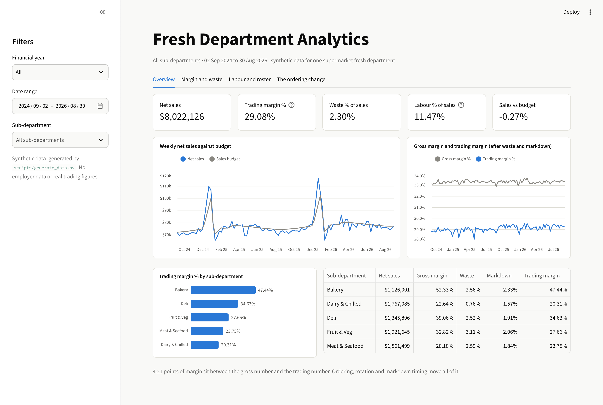
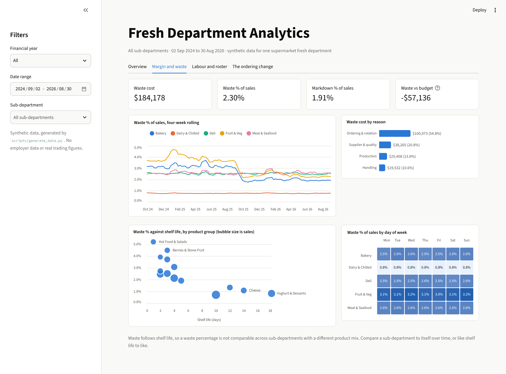
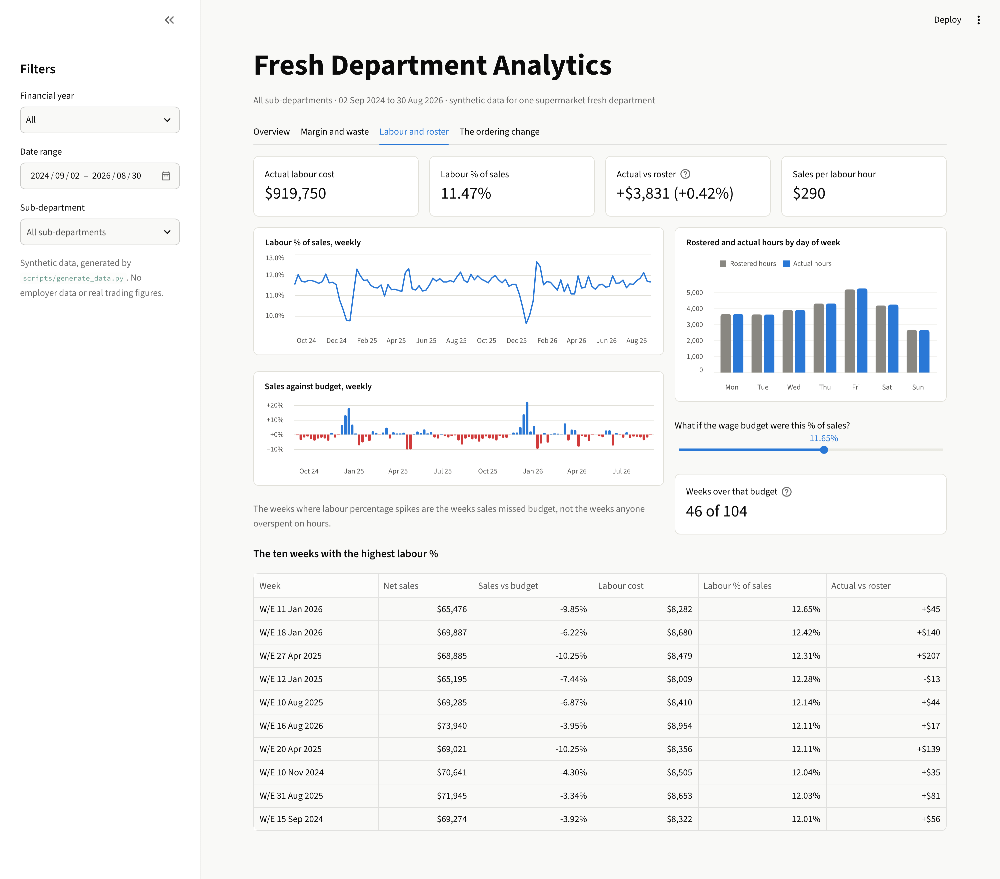
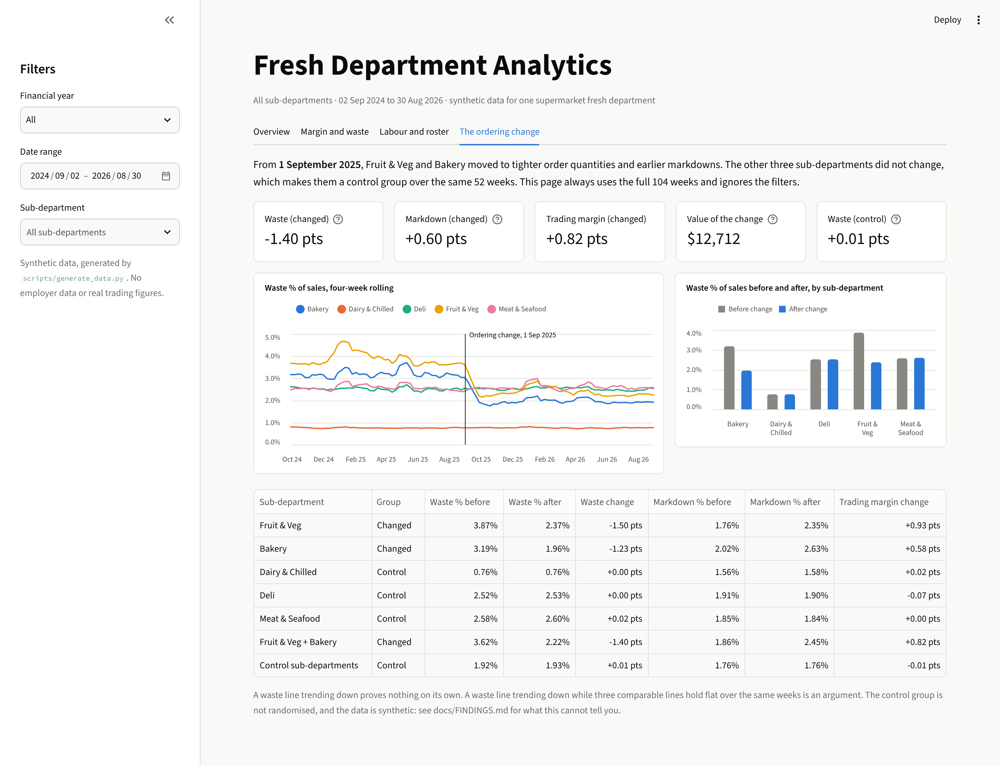

# Fresh Department Analytics

A Power BI report on the margin and labour drivers of a supermarket fresh
department, built on a generated dataset of 104 weeks, and the model, measures
and reasoning behind it.

I manage a fresh department. Every week I own the roster against a budget, the
ordering, the markdowns and the stocktake, and I watch waste and labour move
against each other in ways the standard reports do not explain well. This is that
job modelled properly: a star schema, a measure library that answers the
questions rather than restating the columns, and four pages that argue something.

**The data is synthetic and generated by the script in this repo. No employer
data, systems or records were used, and none of the figures are anyone's real
trading numbers.** The store is invented and sized to be realistic so the model
has real problems to solve.

---

## Screenshots

| | |
|---|---|
|  |  |
|  |  |

---

## The three findings

**Sales landed 0.27% under budget for the year and missed every single week.**
Weekly variance runs from 10.25% under to 22.37% over. The budget follows the
seasonal trend and takes no view on holiday timing, so every week with a public
holiday in it is planned as an ordinary week. The annual number is right by
cancellation.

**Labour percentage moves when sales move, not when hours do.** Payroll variance
to roster was 0.42% across two years, so the roster was worked as written. But
weekly labour ran from 9.61% to 12.65% of sales, and every one of the three worst
weeks is a week sales missed budget by 6 to 10%, not a week anyone overspent on
hours. The roster is written a week ahead against a trend, so it is slow to come
down when trade falls away. Three points of labour percentage, none of it a
rostering failure, and it is fixed a week earlier than anyone is looking.

**Marking down earlier costs 0.60 points of margin and saves 1.40 points of
waste.** From September 2025 two of the five sub-departments moved to tighter
ordering and earlier markdowns. Waste fell 1.40 points, markdown rose 0.60, and
trading margin gained 0.82 points, worth $12,712 over the following 52 weeks. The
other three sub-departments did not change and stayed flat over the same weeks,
which is what turns a line trending down into an argument.

Full working in [`docs/FINDINGS.md`](docs/FINDINGS.md), including what this data
cannot tell you.

---

## The model

Nine tables, 56,787 rows, a star on both sides of a shared date table.

```
                    dim_date  (marked as date table)
                    /    |    \    \
           fact_sales  fact_waste  fact_labour  fact_budget
              |   \        |  \         |            |
   dim_product_group   dim_waste_reason |        dim_sub_department
              |                      dim_role         |
   dim_sub_department --------------------------------+
```

Two decisions I would be asked about:

**Sub-department is its own dimension.** The budget is set at sub-department
level and nowhere finer, so it cannot join to the product-group table, where
`SubDepartment` repeats across fourteen rows. Joining on a non-unique key fans
the budget out and inflates it. The separate table also means a product-group
filter correctly leaves the budget alone, because no budget exists at that
grain. That is the model refusing to invent a number nobody planned.

**Budget is stored daily, not weekly.** It is genuinely set by week, and the
generator phases it across days on the trading profile before writing it. One
date table, one relationship per fact, and dropping a date on an axis never
breaks. The alternative is a week table that needs bridging.

---

## What is in here

```
scripts/generate_data.py    the dataset: calendar, demand, waste, roster, budget
scripts/summarise.py        weekly rollup, and prints every figure quoted above
data/                       9 CSVs, the Excel workbook that gets uploaded, weekly rollup
theme/                      Power BI theme JSON
docs/BUILD_GUIDE.md         build it from scratch, including the Mac problem
docs/DAX_MEASURES.md        every measure, with the reasoning on the ones that are easy to get wrong
docs/DATA_DICTIONARY.md     grain, columns, and what is invented
docs/FINDINGS.md            the analysis, and the limitations
```

```bash
python3 scripts/generate_data.py    # writes data/, including the .xlsx to upload
python3 scripts/summarise.py        # weekly rollup and the verified headline figures
```

Needs Python 3.10 or later, `numpy`, `pandas` and `openpyxl`. Seeded at 2026, so
every run reproduces the same numbers.

---

## Notes on how it was built

**Power BI Desktop is Windows only and I built this on a Mac.** The whole report
was built in Power BI Service in a browser, which changes two things: the model
has to arrive as an Excel workbook rather than loose CSVs, and web modelling has
to be available on the licence. Both are covered in the build guide, along with
the fallback if it is not.

**The figures in this README are printed by a script, not typed in.**
`summarise.py` recomputes every one of them from the raw facts. A write-up where
the numbers are remembered is a write-up where the numbers drift.

**The palette is validated, not chosen.** Categorical hues run blue, orange,
aqua, yellow, magenta in a fixed order that clears a colourblind-safety check on
adjacent pairs at Delta E 9.1 for protanopia against a floor of 8. Three of the
five sit below 3:1 contrast on a light canvas, so every visual using them carries
a legend and direct labels, and every page carries a table.

**No dual-axis charts.** Where two measures of different scale need comparing,
they are two charts stacked on a shared x axis. A second y axis can be slid until
any two series appear to move together and the reader has no way to check.

---

## What it does not do

The relationships in the data are ones I built into the generator, so nothing
here is a discovery. What it demonstrates is the model, the measures and the
reasoning. There are no promotions, no supplier price movement and no
stock-on-hand, all of which drive real fresh margin. It is one store.

---

Prateek Bose. [LinkedIn](https://linkedin.com/in/prateekbose05) ·
[Portfolio optimisation in Python](https://github.com/prateekbose05/Portfolio-Optimisation)

Data and code MIT licensed. See [LICENSE](LICENSE).
